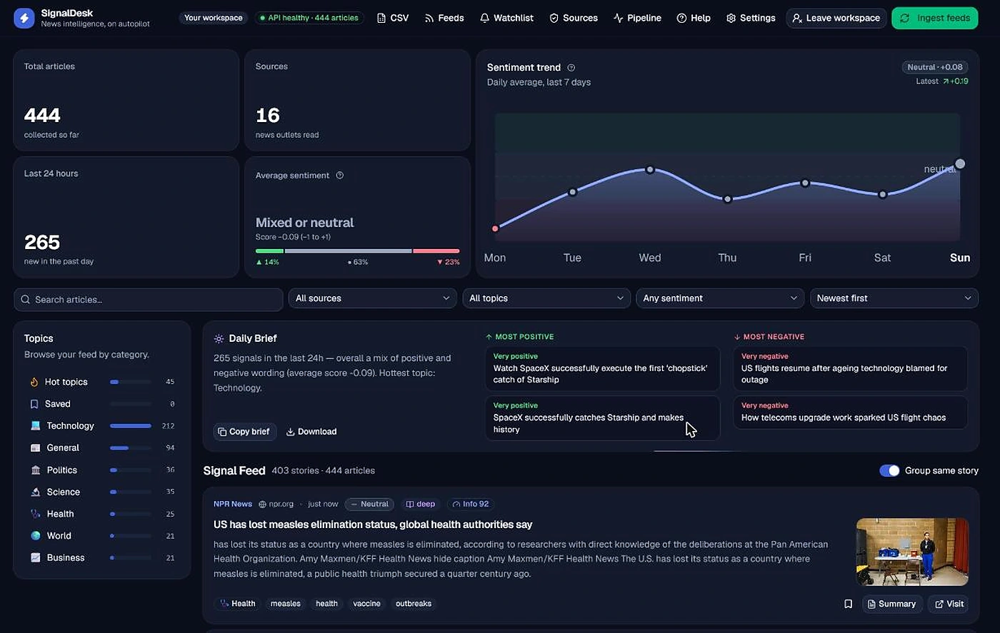
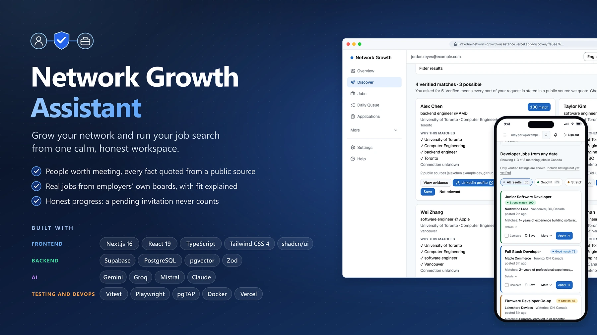

<h1>Shervin Babaei</h1>

I build full-stack web apps, and I like the parts most people skip: the API behind the button, the database underneath it, and the test that proves it still works.

  
  
  
  

Vancouver, BC &nbsp;·&nbsp; BCIT Full-Stack Web Development, 88% average &nbsp;·&nbsp; graduating May 2027

I'm a developer in Vancouver finishing my diploma at BCIT. I work mostly in React, TypeScript, Node.js and PostgreSQL, and I've been teaching myself C++ and local AI models on the side. I care more about software that holds up than software that looks finished: real tests, honest errors, and no feature that quietly makes things up.

When something breaks, I write it down. Seven writeups so far, each one starting from real code in one of my projects.

---

| Commits this year | Pull requests merged | Projects built | Live apps | Tests on one solo app |
| :---: | :---: | :---: | :---: | :---: |
| **1,181** | **67** | **13** | **6** | **1,564** |

---

## Selected work

### ⚡ [SignalDesk](https://github.com/ShervinBabaei2007/SignalDesk) — what the news actually agrees on

  
   
  The SignalDesk dashboard · tap the image to open it full size

SignalDesk reads dozens of news sites, groups the articles that cover the same event, and shows you where those outlets agree and where their numbers differ.

- It groups articles by what they say, not just by their headlines, so two rewrites of the same story end up together.
- For every story it shows what outlets agree on, what they disagree on, and what only one outlet claims.
- It follows a story over several days: who reported it first, who joined later, and how the tone changed.
- It runs with no paid services and no API keys. The AI parts are optional, and the app works without them.

**Built with:**     

**Solo project · built in nine days · 310 automated tests**

[Live app](https://signaldesk-lemon.vercel.app) · [Code](https://github.com/ShervinBabaei2007/SignalDesk) · [Case study](https://shervin-babaei.me/work/signaldesk)

### 🌐 [Network Growth Assistant](https://github.com/ShervinBabaei2007/Network-Growth-Assistance) — networking and a job search in one place

  
   
  Network Growth Assistant · tap the image to open it full size

One place to grow your network, find real jobs and keep track of every application. It never touches LinkedIn for you: you open the profile, you send the message.

- It suggests people to contact and shows you the source behind every fact, so nothing is a guess.
- It pulls jobs from companies' own career pages, then matches them against your resume.
- It tracks applications and follow-ups, so a good lead doesn't quietly go cold.
- 1,564 automated tests, plus 134 that click through the real app in a browser.

**Built with:**     

**Solo project · 263 commits**

[Live app](https://linkedin-network-growth-assistance.vercel.app) · [Code](https://github.com/ShervinBabaei2007/Network-Growth-Assistance) · [Case study](https://shervin-babaei.me/work/network-growth-assistant)

### 🎓 [SkillMatch](https://github.com/ShervinBabaei2007/SkillMatch) — find a workshop, or host one

A board where instructors post short workshops and students sign up. Students and instructors see different things, seats fill up but never overbook, and every sign-up gets a QR code to scan at the door.

**My part:** backend, sign-in and deployment, in a four-week team sprint — 105 of the team's 199 commits.

**Built with:**     

[Live app](https://skillmatch-web.vercel.app/) · [Code](https://github.com/ShervinBabaei2007/SkillMatch) · [Case study](https://shervin-babaei.me/work/skillmatch)

### 🏆 [GitScribe](https://github.com/adriencyr/GitScribe) — top 6 of 36 teams at Hack the Break 2026

Upload two versions of a file and get a suggested description of what changed. I led the front end, and we placed top 6 out of 36 teams in 24 hours.

**Built with:**    

[Live app](https://git-scribe-aybm.vercel.app/) · [Team code](https://github.com/adriencyr/GitScribe)

---

## More projects

| Project | What it does | Built with |
| --- | --- | --- |
| 📝 [**ThinkBoard**](https://shervin-babaei.me/work/thinkboard) · [live](https://mern-thinkboard-plum.vercel.app) | A calm notes app that protects itself from being overloaded: it refuses extra requests after 50 a minute | React, Node.js, Express, MongoDB, Redis |
| 🔗 [**LinkLocker**](https://shervin-babaei.me/work/linklocker) · [live](https://linklocker.northcentralus.cloudapp.azure.com/) | A link shortener running on a real server, with HTTPS, a reverse proxy and Google sign-in | Node.js, Express, MongoDB, Nginx, Azure |
| ⚔️ [**Warrior's Path**](https://shervin-babaei.me/work/mini-rpg-battle) | A fighting game you play in a text window: bosses, loot, and a saved game you can pick back up | Python, tested with pytest |
| 🧠 [**Tic-Tac-Toe AI**](https://shervin-babaei.me/work/tic-tac-toe-minimax) | An opponent that never loses: 1,200 games against a random player, not one loss | Python, recursion |
| 🖼️ [**Jinterest**](https://shervin-babaei.me/work/jinterest) | A mood board that remembers exactly how you left it, with undo and redo, built with no framework | HTML, CSS, JavaScript |
| 🎨 [**PNWX UX Redesign**](https://shervinbabaei2007.github.io/mkdocs-project-2026/) | A full design case study for a medical supply site: research, page structure, wireframes and testing | Figma, MkDocs |
| 🤖 [**Discord AI Bridge**](https://shervin-babaei.me/work/discord-ai-bridge) | A Discord bot that answers with an AI model running on my own laptop | Python, Discord.py |
| 🦙 [**Local AI experiments**](https://shervin-babaei.me/work/ollama-rag) | Small projects for learning how AI models work: sorting a grocery list, asking questions about a PDF | Python, Ollama |
| 📊 [**Job Application Tracker**](https://shervin-babaei.me/work/job-application-tracker) | A command-line tool that keeps every application, status and date in one place | Python, SQLite |

---

## I write about what breaks

Each one starts from real code in one of my projects and ends with what I'd change.

- 🐢 **[How one blocking call froze my Discord bot](https://shervin-babaei.me/writeups/one-blocking-call-froze-my-bot)** — one request in the wrong place, and the bot stopped answering everyone.
- 🎟️ **[The race condition in SkillMatch's sign-up route](https://shervin-babaei.me/writeups/skillmatch-attend-race-condition)** — turning off a button stops one person. It does nothing about two.
- 🔗 **[How my app fetches links it doesn't trust](https://shervin-babaei.me/writeups/fetching-links-you-dont-trust)** — how a link can trick a server into visiting its own network, and the four checks that stop it.
- 🧾 **[Stopping an AI from inventing facts about a person](https://shervin-babaei.me/writeups/stopping-an-ai-from-inventing-facts)** — the check every message has to pass before it goes out.

[All seven writeups →](https://shervin-babaei.me/writeups)

---

## Tools I've shipped with

**Languages**

**Frontend**

**Backend and data**

**Shipping and testing**

**AI**

---

## On GitHub

---

## Open to work

I'm looking for a co-op, internship or junior full-stack role in Vancouver (on-site or hybrid), or anywhere remote. I want a team where code review is normal and where I can own a piece of the product from the first commit to the deploy.

The fastest way to reach me is email. I reply within two business days.

  <a href="https://shervin-babaei.me"><b>Portfolio</b></a> &nbsp;·&nbsp;
  <a href="https://shervin-babaei.me/Shervin-Babaei-Resume.pdf"><b>Résumé</b></a> &nbsp;·&nbsp;
  <a href="https://www.linkedin.com/in/shervin-babaei-5a326a388/"><b>LinkedIn</b></a> &nbsp;·&nbsp;
  <a href="mailto:shervinb22@gmail.com"><b>shervinb22@gmail.com</b></a>

Always learning, building, and improving — one project at a time.

